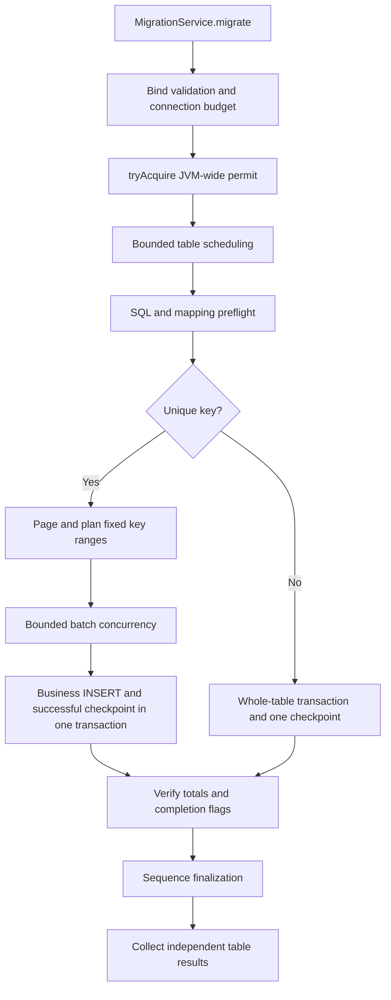

# JDBC migration engine design

This document describes the current implementation. See acceptance-progress.md for validation evidence and remaining work. H2 tests cannot establish all Oracle/PostgreSQL driver behavior.

## Terminology

| Term | Meaning in this project |
| --- | --- |
| Host | The Spring Boot application that depends on the component and calls migrate() |
| Table task | One enabled entry in the tables list |
| Transaction block | A keyed range of at most tables[].batch-size source rows; data and checkpoint commit together on success |
| Checkpoint | Boundaries and state persisted in the target audit database, readable after process exit |
| Coordinator connection | A connection for range planning, summaries, and finalization, separate from worker connections |

For example, a single-worker keyed task with 2500 rows and tables[].batch-size=1000 normally plans blocks of 1000, 1000, and 500 rows. If the first two succeed and the third fails, a new host resumes the third block rather than guessing completion from the largest observed ID. Bounded planning windows avoid loading all table keys into memory first.

This document explains implementation decisions. See [host integration](getting-started.md) for setup and [operations](operations.md) for handling failures.

## Invocation and resources

MigrationRunner accepts two host-supplied DataSources and loads configuration through ConfigData without creating a Spring context. The Spring adapter is discovered through AutoConfiguration.imports, selects host DataSources using source/target annotations, and binds/caches rules on the first call. It registers no ApplicationRunner. There is no REST interface and no participation in host business transactions.

DataSourceConnections only borrows connections, setting READ_COMMITTED and autoCommit=false. It ends unfinished transactions, restores host transaction properties, and returns connections. If rollback fails, it does not enable autoCommit, avoiding an accidental commit. Runner/Spring shutdown closes only the engine; the host always owns DataSources. Endpoint metadata is no longer read to compute identities; the caller must preserve actual endpoints and configuration during recovery.

Only JDK 17 is supported and verified. ExecutorScope calls shutdown on scope exit and waits for all tasks. If interrupted while waiting, it calls shutdownNow, continues waiting for cleanup, then restores the caller's interrupted flag. This replaces newer JDK ExecutorService.close behavior while preserving rollback and Spring shutdown ordering.

## SQL and source-data requirements

YAML is trusted administrator configuration. JSqlParser validates a single SELECT and target INSERT structure; lexical checks ignore question marks inside strings. INSERT must be a single-row VALUES template with the same parameter count as fields. Source queries reject CTEs, parameters, FOR UPDATE, explicit sequence advancement, and other known side-effect syntax. The parser is not a permission sandbox. The source account still needs SELECT-only permissions on required tables, and administrators must not configure functions with side effects.

An empty-result query validates column labels; target ParameterMetaData validates parameter counts; configured keys are then checked for uniqueness and non-nullness. Simple identifiers must begin with a letter/underscore and contain only letters, digits, and underscores; table names may include one schema. Source result labels may be quoted; range SQL uses their actual metadata quoting.

Source data must remain static during migration and retries. Row counts and expected batch counts are checked, but these cannot prove that contents have not changed. Stop business writes to targets as well. There is no cross-database consistent snapshot, CDC, point-in-time source recovery, or external-write coordination.

## Checkpoints for keyed tables

The coordinator plans `(lower, upper]` ranges in lexicographic key order. Composite keys generate component-wise comparison predicates bound through PreparedStatement. A planning window contains at most worker-count x 2 transaction blocks, each with at most tables[].batch-size source rows. Plans must be persisted before execution. Entire-table keys or data are never loaded into memory.

Each worker uses independent source and target connections. In the target transaction it first locks its batch record, streams and writes the range, then locks the table summary to accumulate counts and check skip-limit, finally committing data and the successful checkpoint together. Out-of-order batch completion does not lose gaps.

Restart with the same job-id and task name, read unsuccessful planned batches, then continue planning. Configuration, actual DataSources, and source ranges must remain unchanged; no configuration digest is computed or compared. Successful tasks return existing results. runId identifies this API invocation, while job-id is the durable recovery identity.

## Keyless tables and reimports

Keyless tables require worker-count=1. All reads and writes belong to one target transaction, and bad data is not skipped. batch-size controls executeBatch only, not commit. A coordinator connection may record processing progress separately, but it does not represent committed data. After process interruption, the target transaction rolls back and the next attempt restarts the whole table.

Default APPEND_RESUME does not clear targets. Explicit CLEAR_AND_REIMPORT uses DELETE to avoid database-specific TRUNCATE implicit-commit differences. Keyed tables clear and commit the prepared flag before importing; recovery with the same job-id does not clear again. Keyless tables place DELETE, all INSERTs, and the successful checkpoint in one transaction. A new full reimport needs a new job-id and does not overwrite old audit history.

Deployment owns target triggers, foreign keys, and permissions. There is no automatic cascade, temporary constraint disabling, or automatic upsert. Independent tables run in parallel; one failure does not prevent others from completing. MigrationException.result() retains per-table status. A batch failure stops queued batches of that table from starting. Already running batches finish their transaction handling, and unexecuted ranges remain recoverable checkpoints.

## Failure handling

Batch data errors first roll back the entire transaction block, then use per-row savepoints to identify skippable rows. Skip budgets accumulate across batches per job-id/table and are serialized through the summary row lock; workers cannot each consume the full budget. SQLState 22 and explicit constraint errors may be classified as data errors; schema, permission, and network errors cannot be skipped.

Transient errors are retried with capped exponential backoff only after rollback is confirmed. Retry counts exclude the initial attempt and are persisted cumulatively for audit. After a COMMIT exception, a new connection reads the checkpoint FOR UPDATE and waits for the original transaction. Confirmed success returns; confirmed failure permits retry only according to classification. If verification fails, the result is COMMIT_UNKNOWN. The caller must restore connectivity and verify with the same job-id, not blindly append under a new job.

Sequences are calibrated only after data commits. The maximum target ID must be exactly representable as BIGINT. Only non-cycling named sequences with increment 1 are supported; an already higher position is preserved. Nontransactional H2 ALTER SEQUENCE and PostgreSQL setval effects are handled separately. Failure is FINALIZATION_FAILED; retries of the same task skip the data phase and repeat idempotent finalization. Empty tables need no advancement. Source sequence cache state is not copied.

## JVM execution coordination and transactional row locks

The default JdbcMigrationEngine public execute entry uses a static, single-permit Semaphore.tryAcquire. Any overlapping call fails immediately, regardless of Runner, Spring context, or target table, before borrowing connections. Individual Runners/engines also reject reentry. Hosts supplying a custom MigrationEngine own its execution coordination.

The executing call owns the permit. close only requests cancellation and waits for cleanup; it does not release the permit. Success, exceptions, interruption, and cancellation all wait through ExecutorScope for tables/workers and connection transactions to finish before execute's finally releases it. Closing an unused Runner does not affect an active migration.

This memory mechanism does not coordinate different processes. Deployment and operations must ensure the old migration process exits before recovery starts, and should avoid loading separate copies of the engine in isolated classloaders in one process. Cross-process takeover, leases, and fencing are not provided. Tests no longer simulate parallel stale-owner takeover.

Execution coordination consumes no database connection. A keyed table with W workers needs source W+1 and target W+1; a keyless table needs source 1 and target 2. Batch and summary row locks remain to prevent races in counts, skip budgets, and commit verification. They release with transactions and create no separate lock records.

## Auditing and memory boundaries

Auditing uses one precreated table: batch_no=0 stores summaries and positive numbers store batches. There are no internal lock records. Fields include boundaries, expected/committed/skipped/processed counts, retries, preparation/planning/data-complete flags, status, timestamps, and redacted error categories. DDL is in src/main/resources/db; the running engine never creates tables. See [audit design](audit.md) for the field reference and boundary examples.

Error results expose only categories, SQLState, and vendor codes, not passwords, full SQL, bound values, or row contents. Audit failures must not be reported as business success. Audit history/checkpoints may contain key values and still require database permissions and retention controls.

JdbcRows reads row by row. Ordinary JDBC batches are constrained by both batch-size and max-batch-bytes; converted sizes are estimates, excluding driver-internal buffering. BLOB/CLOB streams are consumed immediately for the current row without accumulating multiple LOBs; streams are released before LOB objects. A field exceeding max-lob-size fails; CLOB sizes use UTF-16 units. More concurrent workers increase driver buffering and network usage; byte settings are not a JVM RSS limit.

## Validation layers

Unit/component tests cover transactions, boundaries, configuration, SQL, JDBC contracts, and fault injection. JaCoCo measures Surefire only, excluding Failsafe E2E. E2E uses two actual H2 TCP servers, independent file databases, Spring YAML, and method entry points, covering 10,000 rows, TLS trust, disconnects, and recovery in a new JVM. Mock PostgreSQL dialect JDBC tests do not replace a real PostgreSQL run. Real Oracle TCPS, PostgreSQL drivers, and IAM/ECS require separate validation in those environments.
