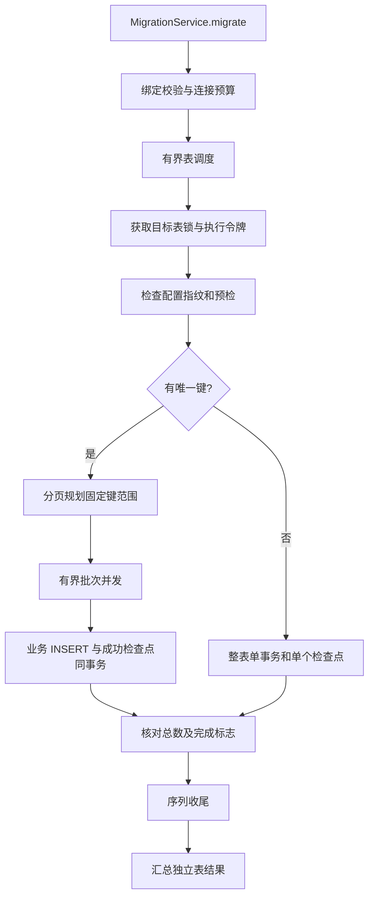

# JDBC 迁移引擎设计

本文件描述当前实现。验证证据与剩余验收工作见 acceptance-progress.md；H2 测试不能证明 Oracle/PostgreSQL 驱动的全部行为。

## 阅读前先统一术语

| 术语 | 本项目里的意思 |
| --- | --- |
| 宿主 | 引入组件并调用 migrate() 的 Spring Boot 应用 |
| 表任务 | tables 列表中一个启用的配置项 |
| 事务块 | 有键表中最多 commit-size 条源记录的范围，成功时数据和检查点一起提交 |
| 检查点 | 目标审计库中持久化的边界与状态，进程退出后仍能读取 |
| 协调连接 | 负责规划范围、汇总和收尾的连接，与 worker 连接分开 |
| guard | 独立持有目标表执行锁的连接，防止本组件的另一个执行者同时接管 |
| 执行令牌 | 接管时更换的随机值，旧执行者继续写入前必须核实自己仍有所有权 |
| 指纹 | 对关键迁移配置计算的摘要，避免用不同规则误续跑旧数据 |

例如 2500 行、commit-size=1000 的单 worker 有键任务，通常规划三个事务块，分别处理 1000、1000、500 行。如果前两块成功、第三块失败，新宿主从第三块继续，而不是从最大已见 ID 猜测是否完成。实际实现采用有界窗口，避免先把全表键装进内存。

本篇解释实现原因。如何接入和处理失败请分别看 [接入步骤](getting-started.md)及 [运维指南](operations.md)。

## 调用与资源

AutoConfiguration.imports 注册自动配置。MigrationService 始终可注入，默认在第一次调用时绑定并校验 YAML，缓存成功配置。run-on-startup 仅控制 ApplicationRunner 是否同步调用同一入口。没有 REST 接口、业务 DataSource Bean 或宿主事务管理器依赖。

MigrationConnectionPools 延迟创建两个独立 Hikari 池，连接使用 READ_COMMITTED、autoCommit=false。Spring 关闭时销毁引擎和连接池；每次执行独立管理游标、语句、借用连接。单个引擎拒绝重叠 execute 调用。

编译和最低运行版本为 Java 17。ExecutorScope 在离开作用域时 shutdown 并等待所有任务结束；等待被中断时 shutdownNow，继续等待资源清理完成，最后恢复调用线程的中断标志。该实现替代新版 JDK 的 ExecutorService.close，保持事务回滚和 Spring 关闭顺序。

## SQL 与源数据条件

YAML 是受信任管理员配置。JSqlParser 验证单个 SELECT 和目标 INSERT 结构，词法检查忽略字符串中的问号；INSERT 必须是单行 VALUES 模板，参数数与 fields 相同。源查询不接受 CTE、参数、FOR UPDATE 和显式序列推进等已知副作用语法。解析器不是权限沙箱，源账号仍应只有所需表的 SELECT 权限，管理员不能配置有副作用的函数。

通过空结果查询校验列标签、通过目标 ParameterMetaData 校验参数数量，再检查配置键是否唯一、非空。简单标识符仅允许字母/下划线开头及后续字母数字下划线；表名可带一个 schema。源结果标签可以带引用，范围 SQL 按实际元数据引用。

源数据在迁移和重试期间必须保持静态。行数及各批次预期数量会检查，但不能证明内容未被更新。目标也应停止业务写入。没有跨库一致快照、CDC、任意时点源恢复或外部写入协调。

## 有键表的检查点

协调线程按键的字典序规划 `(lower, upper]` 范围，联合键生成逐项比较谓词并使用 PreparedStatement 绑定。规划窗口最多 worker-count × 2 个事务块，每块最多 commit-size 条源记录；规划持久化后才能执行。不会把全表键或数据加载到内存。

每个 worker 独立使用源、目标连接，在目标事务中先锁定自己的批次记录，核实执行者令牌，流式读取并写入该范围，再锁定表汇总行累计计数、检查 skip-limit，最终将成功检查点和数据一起提交。不同批次即使乱序完成也不会丢失缺口。

重启保持同一 job-id 和任务名，读取未成功的已规划批次，之后继续规划。指纹包括源/目标身份、SQL、字段、主键、模式、序列配置、commit-size、skip-limit、max-lob-size；性能参数如 worker-count 可以调整。成功任务返回已有结果。runId 是本次 API 调用标识，持久化恢复身份使用 job-id。

## 无键表与重导

无键表 worker-count 必须为 1，全部读取和写入属于一个目标事务，坏数据不跳过。batch-size 只控制 executeBatch，不能触发 commit。处理进度可以由协调连接单独记录，但它不代表已提交数据。进程中断后的目标事务回滚；下次从整表开始。

默认 APPEND_RESUME 不清除目标。显式 CLEAR_AND_REIMPORT 使用 DELETE，避免不同数据库 TRUNCATE 的隐式提交差异。有键表先清除并提交 prepared 标记，再导入；同一 job-id 恢复不再清除。无键表将 DELETE、所有 INSERT 和成功检查点置于同一事务。新一轮全量重导需要新的 job-id，不覆盖旧审计历史。

目标触发器、外键及权限由部署方负责；不自动级联、不临时禁用约束、不自动 upsert。独立表并行，一表失败不阻止其他表完成；最终 MigrationException.result() 保留逐表状态。表内批次失败后停止启动排队批次，已经运行的批次完成自身事务处理，未执行范围保留为待恢复检查点。

## 故障处理

批量数据错误先回滚整个事务块，再使用逐行保存点定位可跳过行；跳过额度按 job-id/表跨批次累计，由汇总行锁串行检查，不能由多个 worker 分别消费完整额度。SQLState 22 和明确的约束错误可归类为数据错误；结构、权限、网络故障不能跳过。

瞬时错误仅在确认回滚后按上限指数退避重试。重试计数不包含初次执行，持久化累计次数供审计。COMMIT 调用异常后，新连接使用 FOR UPDATE 读取检查点，等待原事务完成；确认成功即返回，确认未成功才按错误分类决定重试。无法核实则 COMMIT_UNKNOWN，调用方必须恢复连接后使用同一 job-id 核实，不能直接换新任务盲目追加。

序列只在数据提交完成之后校准，目标 ID 最大值必须可精确表示为 BIGINT；仅支持步长 1、非循环命名序列，已有水位更高时保持不变。H2 ALTER SEQUENCE 和 PostgreSQL setval 的非事务性效果独立处理，失败标记 FINALIZATION_FAILED；相同任务重试跳过数据阶段，再执行幂等收尾。空表无需推进。此机制不复制源数据库序列缓存状态。

## 表锁与旧执行者隔离

审计表中的保留 job-id `__table_lock__` 保存规范化目标表的锁记录。独立 guard 连接持有 batch_no=0 的 FOR UPDATE NOWAIT 行锁；新的执行者更新 batch_no=1 的随机令牌，然后分别等待该目标表已有协调事务、批次事务排空，再开始清除或恢复。两次排空使用独立事务，避免与 worker 的“批次行锁 → 汇总行锁”顺序形成死锁。

worker 必须先获取自身批次锁，再读取令牌。旧 guard 丢失后，旧 worker 要么已持有批次锁，新执行者等待其事务结束；要么晚于令牌更换拿到锁，令牌检查阻止其写入。此约定依赖 READ_COMMITTED 和所有执行者共享同一审计表。普通业务程序不参与该协议，因此仍需停写。

协调线程在准备/清除、范围规划、汇总和序列收尾事务中先锁定表汇总行，再核实令牌。序列收尾将行锁保留到最终状态提交；H2 ALTER SEQUENCE 不隐式提交当前事务，但序列变更不随回滚撤销，这一行为已有真实 H2 锁测试。[H2 命令文档](https://h2database.com/html/commands.html#alter_sequence)

## 审计与内存边界

审计只使用一个预建表，batch_no=0 保存表汇总，正数记录批次；保留任务保存锁。字段包含边界、配置指纹、预期行数、已提交/跳过/处理行数、重试次数、准备/规划/数据完成标志、状态、开始与更新时间、脱敏错误类别。DDL 位于 src/main/resources/db，运行引擎不自动建表。

错误结果只暴露分类、SQLState 和厂商错误码，不打印密码、完整 SQL、绑定值或行内容。审计错误不能伪装为业务成功。审计历史和检查点可能包含键值，仍需数据库权限与保留策略保护。

JdbcRows 按行读取，普通 JDBC batch 同时受 batch-size 与 max-batch-bytes 约束；转换值大小是估算值，驱动内部缓冲另计。BLOB/CLOB 在当前行立即消费流，不累积多条 LOB；释放顺序为流、LOB 对象。单字段超过 max-lob-size 失败，CLOB 按 UTF-16 单元折算。并发线程越多，驱动缓冲与网络资源占用也越多；不能将字节配置等同于 JVM RSS 上限。

## 验证层次

单元/组件测试验证事务、边界、配置、SQL、JDBC 契约及故障注入；JaCoCo 只统计 Surefire，不包含 Failsafe E2E。E2E 使用两个真实 H2 TCP 服务、独立文件数据库、Spring YAML 与方法入口，覆盖 10,000 行、TLS 信任验证、断连与新 JVM 恢复。PostgreSQL 方言的 mock JDBC 测试不替代真实 PostgreSQL；真实 Oracle TCPS、PostgreSQL 驱动、IAM/ECS 需在相应环境另行验收。
